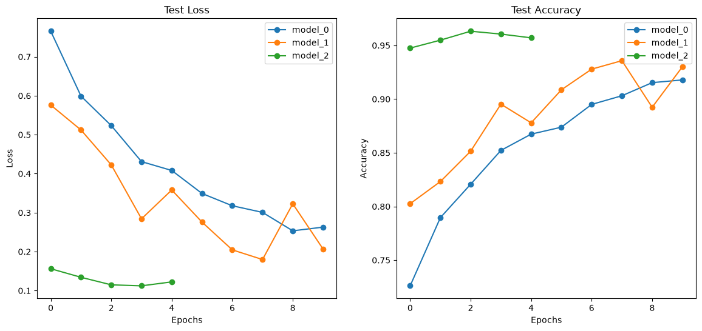
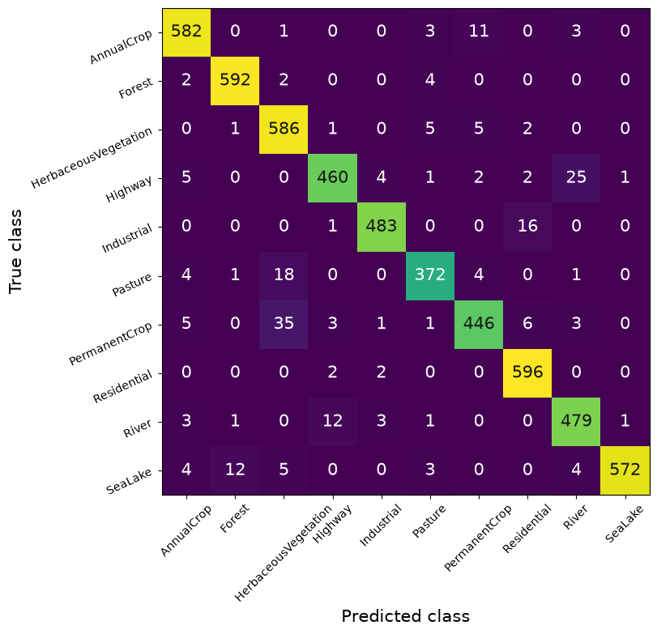

# EuroSAT Uydu Görüntüsü Sınıflandırma

Sentinel-2 uydu görüntülerini arazi kullanımına göre 10 sınıfa ayırır: tarım arazisi, orman, otoyol, nehir, yerleşim alanı ve diğerleri.

Bu projede aynı veri üzerinde üç CNN karşılaştırılıyor: sıfırdan yazılmış basit bir CNN, BatchNorm ve Dropout eklenmiş daha derin bir CNN ve ImageNet'te önceden eğitilmiş ResNet18 (transfer learning).

## Veri

- **Kaynak:** [EuroSAT](https://github.com/phelber/EuroSAT) (Helber vd., 2019), `torchvision.datasets.EuroSAT` ile indirildi
- **Boyut:** 27.000 RGB görüntü, 64×64 piksel, 10 sınıf

| Sınıf | Görüntü | Sınıf | Görüntü |
|---|---|---|---|
| AnnualCrop | 3000 | Pasture | 2000 |
| Forest | 3000 | PermanentCrop | 2500 |
| HerbaceousVegetation | 3000 | Residential | 3000 |
| Highway | 2500 | River | 2500 |
| Industrial | 2500 | SeaLake | 3000 |

Veri seti repoya dahil değildir. Notebook'un ilk hücresi veriyi `data/` klasörüne indirir.

## Train / test ayrımı

Görüntüler her sınıf kendi içinde **%80 train / %20 test** olacak şekilde `data/eurosat_split/train` ve `data/eurosat_split/test` klasörlerine kopyalandı (`random.seed(42)`). Böylece sınıf oranları iki tarafta da korundu ve veri `ImageFolder` ile yüklenebildi.

- Train: 21.600 görüntü
- Test: 5.400 görüntü

## Ön işleme

| | Train | Test |
|---|---|---|
| Augmentation | Yatay/dikey çevirme, ±30° döndürme | — |
| Normalize | ImageNet mean/std | ImageNet mean/std |

Uydu görüntülerinin "yukarısı" olmadığı için çevirme ve döndürme anlamlı augmentation'lar. Normalize değerleri ResNet18'in eğitildiği ImageNet değerleriyle aynı tutuldu.

## Modeller

| Model | Mimari | Parametre |
|---|---|---|
| `model_0` | 2 conv bloğu (32 kanal) + Linear | 110.570 |
| `model_1` | 3 conv bloğu (32 → 64 → 128 kanal), BatchNorm, AdaptiveAvgPool, Dropout(0.3) | 289.194 |
| `model_2` | ResNet18 (ImageNet ağırlıkları), son katman 1000 → 10 sınıf | 11,2 milyon |

Tüm modeller `CrossEntropyLoss`, Adam ve batch size 32 ile GPU'da (GTX 1660 Ti) eğitildi.

## Sonuçlar

| Model | Learning rate | Epoch | Son test doğruluğu | En iyi test doğruluğu |
|---|---|---|---|---|
| model_0 (CNN) | 0.001 | 10 | %91,8 | %91,8 |
| model_1 (CNN v2) | 0.001 | 10 | %93,0 | %93,6 |
| model_2 (ResNet18) | 0.001 | 10 | %89,6 | %94,7 |
| **model_2_v2 (ResNet18)** | **0.0001** | **5** | **%95,7** | **%96,3** |



**Gözlemler**

- BatchNorm, Dropout ve daha fazla kanal, aynı epoch sayısıyla basit CNN'e göre yaklaşık 1–2 puan kazandırdı.
- ResNet18, `lr = 0.001` ile her epoch'ta zikzak çizdi (%81 ile %95 arası) ve 10 epoch sonunda kendi CNN'imizin gerisinde kaldı. Büyük learning rate, ImageNet'ten gelen hazır ağırlıkları bozuyor.
- Aynı model `lr = 0.0001` ile ilk epoch'ta %94,7'ye ulaştı ve 5 epoch'ta en iyi sonucu verdi. Transfer learning'de learning rate seçimi, model seçimi kadar önemli.
- Eğitim boyunca test doğruluğu train doğruluğundan biraz yüksek kaldı. Sebebi, train görüntülerine augmentation uygulanması ve Dropout'un sadece eğitimde açık olması. Overfitting gözlenmedi.

Notlar: Doğruluk değerleri batch ortalamasıdır. Augmentation ve DataLoader karıştırması rastgele olduğu için tekrar çalıştırmalarda sonuçlar ±1 puan değişebilir.

## Confusion matrix (model_2_v2)



| Sınıf | Doğru / Toplam | Recall |
|---|---|---|
| Residential | 596 / 600 | %99,3 |
| Forest | 592 / 600 | %98,7 |
| HerbaceousVegetation | 586 / 600 | %97,7 |
| AnnualCrop | 582 / 600 | %97,0 |
| Industrial | 483 / 500 | %96,6 |
| River | 479 / 500 | %95,8 |
| SeaLake | 572 / 600 | %95,3 |
| Pasture | 372 / 400 | %93,0 |
| Highway | 460 / 500 | %92,0 |
| PermanentCrop | 446 / 500 | %89,2 |

En sık karıştırılan sınıflar görsel olarak da birbirine benziyor:

| Gerçek → Tahmin | Hata sayısı |
|---|---|
| PermanentCrop → HerbaceousVegetation | 35 |
| Highway → River | 25 |
| Pasture → HerbaceousVegetation | 18 |
| Industrial → Residential | 16 |
| River → Highway, SeaLake → Forest | 12'şer |

Yukarıdan bakıldığında meyve bahçeleri yeşil bitki örtüsüne, otoyollar nehirlere (ikisi de görüntüyü kesen ince bir çizgi), sanayi alanları da yerleşim alanlarına benziyor.

## Geliştirme fikirleri

- Görüntüleri 224×224'e büyütmek. ResNet18 bu boyutta eğitildiği için ince detayları (otoyol / nehir) daha iyi ayırabilir, ama eğitim yaklaşık 10 kat yavaşlar.
- Daha fazla epoch ve learning rate scheduler.
- Validation seti ayırıp en iyi epoch'u ona göre seçmek.

## Kaydedilen dosyalar

`models/` klasöründe her modelin `state_dict`'i var:

| Dosya | Model | Boyut |
|---|---|---|
| `eurosat_model_0.pth` | model_0 (CNN) | 0,4 MB |
| `eurosat_model_1.pth` | model_1 (CNN v2) | 1,2 MB |
| `eurosat_model_2.pth` | model_2_v2 (ResNet18, lr = 0.0001) | 45 MB |

En iyi modeli yükleyip tek bir görüntü için tahmin:

```python
import torch
from torch import nn
from torchvision import models, transforms
from PIL import Image

class_names = ['AnnualCrop', 'Forest', 'HerbaceousVegetation', 'Highway', 'Industrial',
               'Pasture', 'PermanentCrop', 'Residential', 'River', 'SeaLake']

model = models.resnet18()
model.fc = nn.Linear(model.fc.in_features, len(class_names))
model.load_state_dict(torch.load("models/eurosat_model_2.pth", weights_only=True))
model.eval()

transform = transforms.Compose([
    transforms.ToTensor(),
    transforms.Normalize(mean=[0.485, 0.456, 0.406], std=[0.229, 0.224, 0.225]),
])

img = Image.open("ornek.jpg").convert("RGB")
with torch.inference_mode():
    pred = model(transform(img).unsqueeze(0)).argmax(dim=1)

print(class_names[pred.item()])
```
